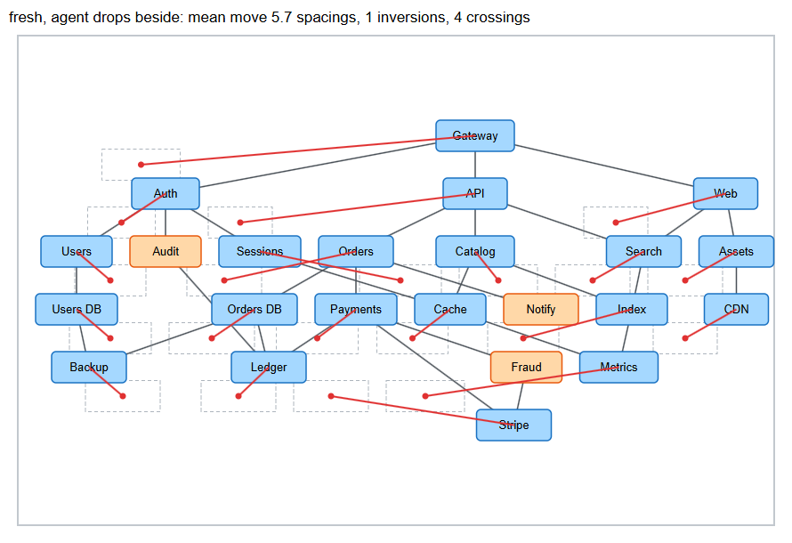
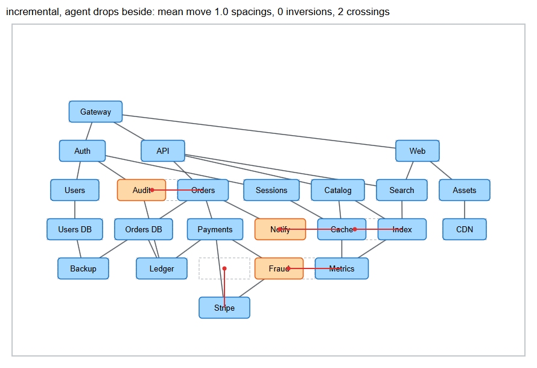
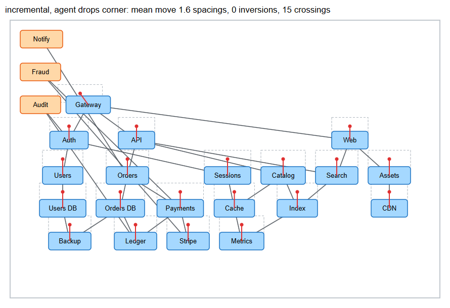

# Spike: stable incremental layout when an agent writes into a tidy frame

Refs redaphid/draw#138. Throwaway code on `spike/excalidraw-draw138-incremental-layout`, built on PR #59 (`feat/arrange-elk`) merged with `master`.

## Question

Can PR #59's arrange engine keep the human's mental map when an agent adds shapes to a frame the human already tidied? "Keep the mental map" means three things here. Existing nodes barely move. No two existing nodes swap order. The result has no more edge crossings than a fresh layout.

## What I built

- `LayoutOptions.mode: "fresh" | "incremental"` and `LayoutNode.previous` in `packages/element/src/arrange.ts`. `ArrangeRequest.mode` passes it through. In incremental mode `planArrange` seeds every node with its current top-left. It then aligns the new layout on the median offset of all nodes instead of re-centering it in the frame, so a few far-away newcomers cannot drag the drawing.
- `packages/excalidraw/arrange/elkLayout.ts` maps incremental to ELK layered's `INTERACTIVE` cycle breaking, layering, crossing minimization and node placement, with `interactiveReferencePoint=TOP_LEFT`. Each child gets its `x`, `y`.
- `packages/element/src/layoutStability.ts`, pure metrics. Displacement by center, raw and with the drawing's common shift removed. In-layer order inversions with Kendall's tau. Cross-layer flips. Crossings between straight center-to-center edges, which is what the human sees, because bound arrows stay straight after an arrange.
- `packages/excalidraw/tests/layoutStability.test.tsx`. A 20-service diagram with 25 edges, scattered in a frame and tidied with a fresh arrange. An agent then adds three nodes: a leaf (`Notify`), a node spliced into a chain (`Payments > Fraud > Stripe`), and a node with a long edge across the diagram (`Auth > Audit > Ledger`). The test re-arranges with four variants and two drop policies, prints the table, and pins the findings. Set `SPIKE_OUT` to also write an SVG per run and `results.json`.

The two drop policies model where the agent's new shapes sit before the arrange.

- **beside.** Each new node sits one rank below its bound source, which is what an agent writing with `startElementId` would do.
- **corner.** New nodes are stacked at the frame's top-left. ELK has no "unplaced" node in interactive mode, so this stands in for the issue's "new nodes carry no position".

## Evidence

Displacement is in node spacings (40px at the default grid) over the 20 pre-existing nodes. "Aligned" removes the common shift, so fresh is not penalised for re-centering. Crossings count all 23 nodes and 30 edges. The tidy frame had 1 crossing.

| Drop | Variant | Mean move | Max move | Aligned mean | Moved of 20 | In-layer inversions | Kendall tau | Layer flips | Crossings | ELK ms |
| --- | --- | --- | --- | --- | --- | --- | --- | --- | --- | --- |
| beside | fresh | 5.75 | 18.85 | 4.31 | 17 | 1 | 0.95 | 0 | 4 | 70 |
| beside | **incremental** | **1.05** | 5.15 | **1.05** | **5** | **0** | **1.00** | **0** | **2** | 54 |
| beside | order-only | 5.73 | 25.15 | 4.11 | 11 | 0 | 1.00 | 0 | 2 | 37 |
| beside | semi | 5.39 | 18.77 | 4.31 | 17 | 1 | 0.95 | 0 | 4 | 68 |
| corner | fresh | 5.75 | 18.85 | 4.31 | 17 | 1 | 0.95 | 0 | 4 | 76 |
| corner | incremental | 1.58 | 1.63 | 0.08 | 4 | 0 | 1.00 | 0 | **15** | 43 |
| corner | order-only | 4.92 | 19.95 | 3.37 | 17 | 0 | 1.00 | 0 | 9 | 58 |
| corner | semi | 5.39 | 18.77 | 4.31 | 17 | 1 | 0.95 | 0 | 4 | 73 |

`order-only` makes only crossing minimization interactive. `semi` is a fresh layout with `crossingMinimization.semiInteractive`. Neither keeps nodes in place, because both re-run layering. Full numbers are in [`138/results.json`](138/results.json). ELK times are one main-thread call in jsdom on this machine. They are not the Worker or Durable Object timing the issue asks about.

Both modes leave an already-tidy frame untouched when nothing was added (max move 0, asserted in the test).

The pictures show the tidy positions as dashed outlines and each move as a red line from the old center. Agent nodes are orange.

Fresh, agent drops beside. 17 of 20 nodes move, and the drawing re-centers.

Incremental, agent drops beside. 15 of 20 nodes stay exactly on their outlines. `Orders`, `Cache`, `Index` and `Metrics` slide sideways within their layer to make room. `Stripe` drops one layer under the spliced-in `Fraud`.

Incremental, agent drops in the corner. The old drawing keeps its shape, apart from a uniform 63px slide that the frame-margin clamp causes. ELK keeps the three new nodes above `Gateway`, where their y put them, and the result has 15 crossings.

Against the issue's continue criteria:

| Criterion | Result |
| --- | --- |
| Mean displacement under one node spacing | 1.05 spacings (42px). A 2px miss on the literal 40px unit. 15 of 20 nodes move 0px. |
| No order inversions | 0 in-layer, 0 across layers. Fresh has 1. |
| Fresh crossings no more than 20% better | Fresh is worse: 4 against 2. |
| Worker CPU under 50ms for 50 nodes | Not measured. That is draw-side work (day 4). |

## Answer

Yes, with one condition: PR #59's engine with ELK's INTERACTIVE strategies keeps the mental map of a tidy frame, as long as each new node is first seeded next to a node it is bound to. Left unplaced, new nodes strand where their coordinates say, and the frame ends with 15 crossings against a fresh layout's 4.

## What I would build next

1. In draw's `arrange` op, seed every new node that has no position from its bound neighbour (one rank below its source, or above its target) before an incremental arrange. The engine stays as it is. This is the whole difference between 2 and 15 crossings above.
2. Keep the median alignment, and drop the frame-margin clamp for incremental. Grow the frame up or left instead, so stranded newcomers never slide the human's drawing.
3. Measure elkjs in the Worker under the workers pool at 50 nodes (issue day 4) before choosing the Worker over the live tab's `ask(task)`.
4. Re-run this fixture on two or three more diagram shapes (wide fan-out, deep chain) before trusting a single fixture. A new node in a crowded layer pushes its neighbours sideways, and the max move here (5 spacings) came from that.
