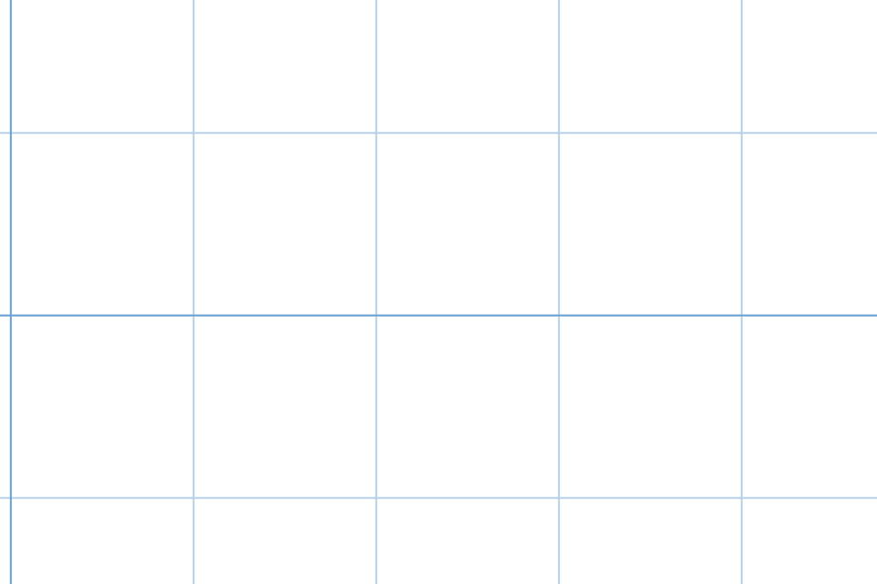
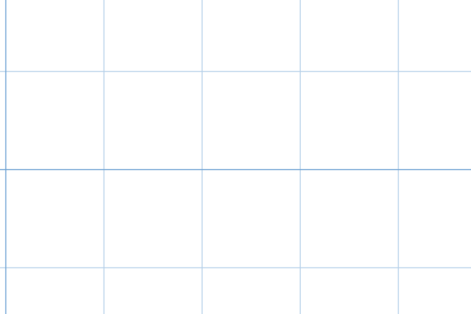
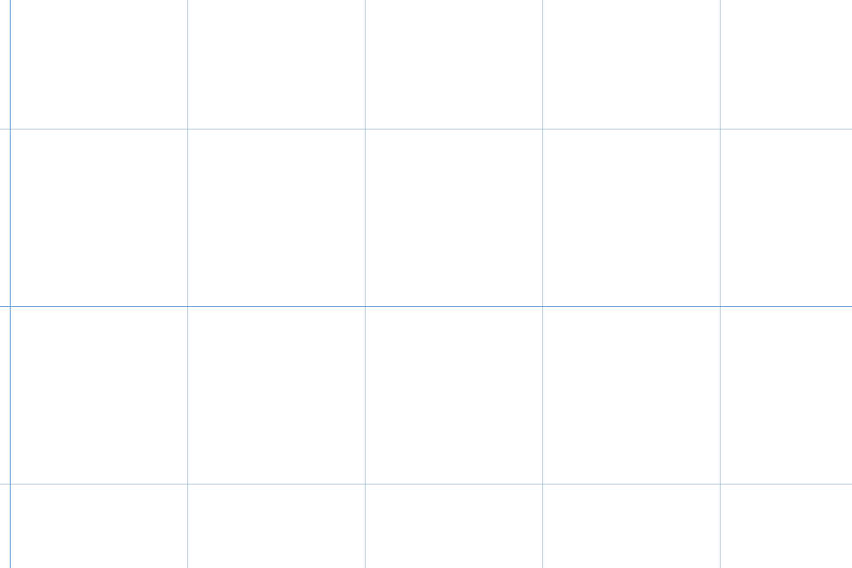
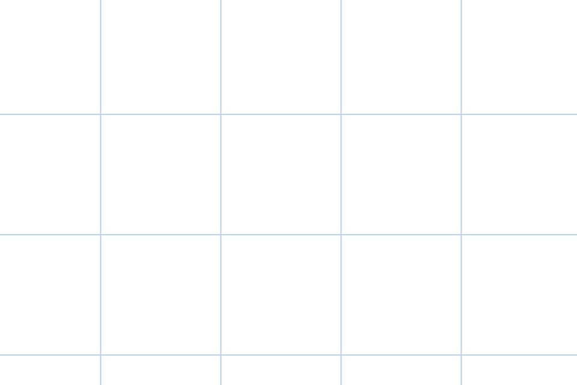
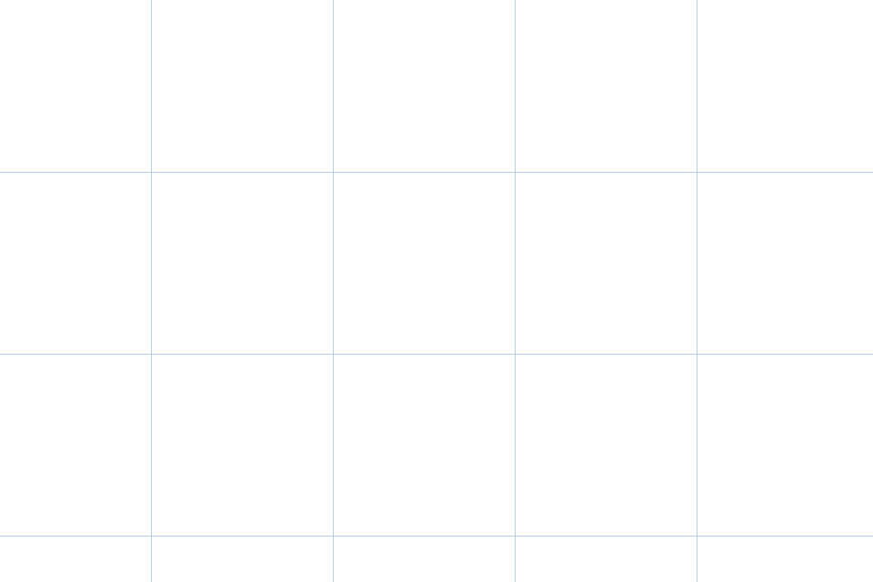
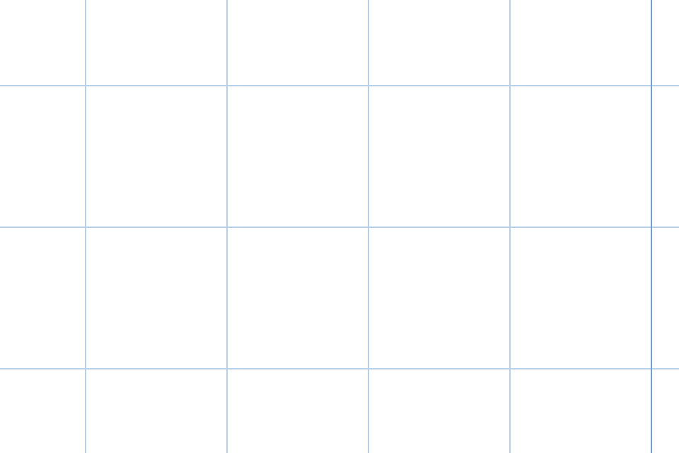
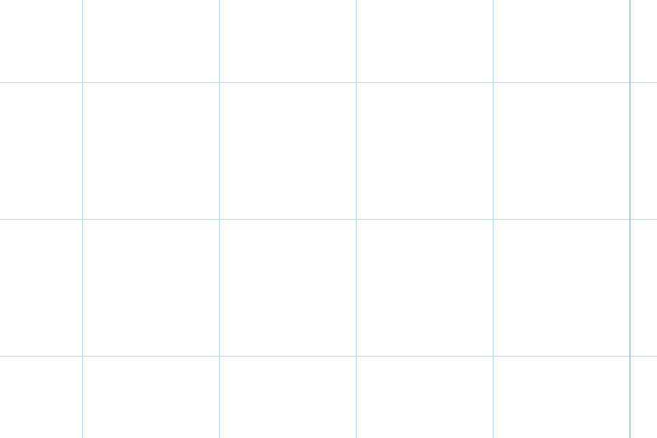
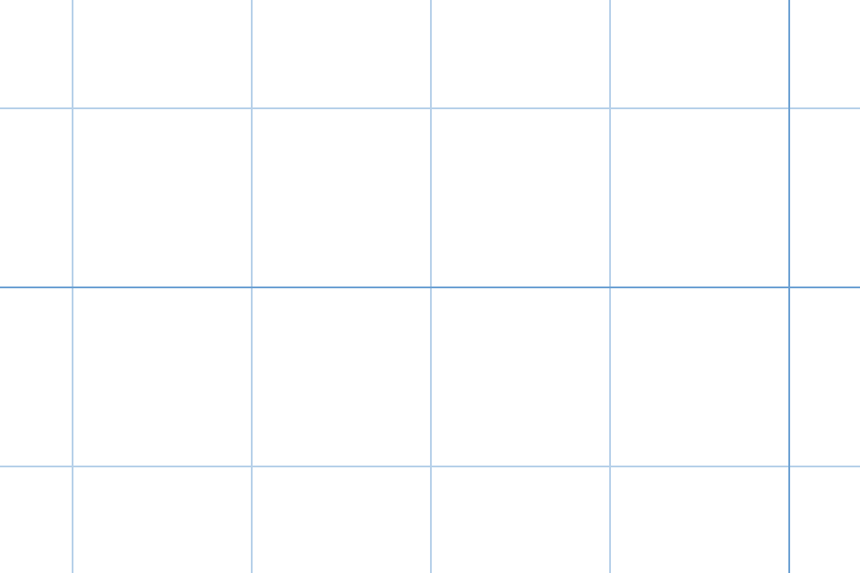
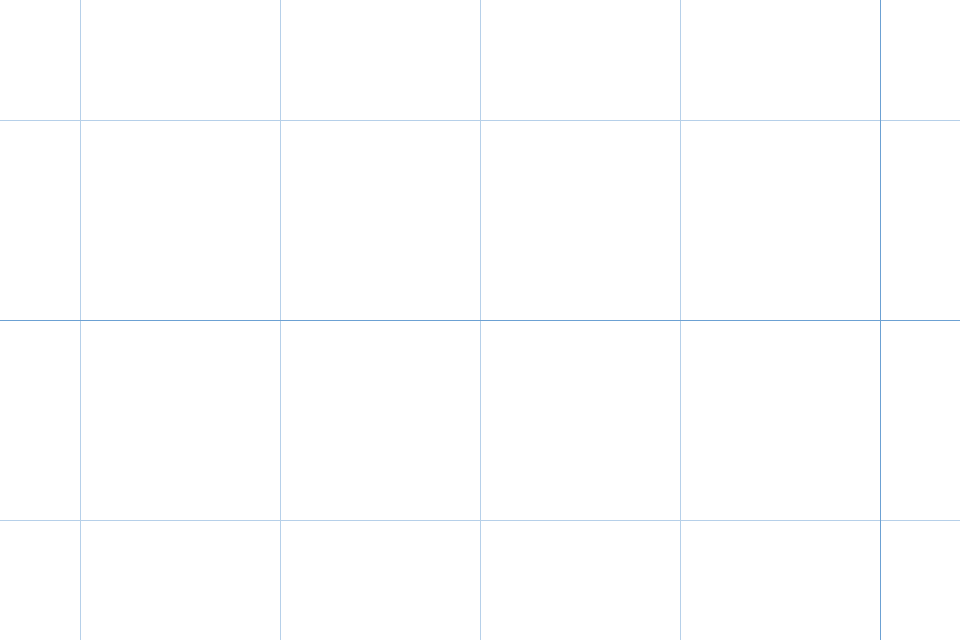

# Spike #85: theme backdrops as world-anchored SVG patterns

Throwaway. Not for merge.

## Question

Should a theme backdrop (graph paper, dot grid, paper texture) be a CSS layer behind a transparent canvas, or a pattern drawn on the canvas next to `strokeGrid`? It must stay sharp from 1x to the fork's 1e6x zoom, must not add main-thread cost to a pan, and must show in draw's GPU view layer during gestures.

## Answer

Draw it on the canvas as a pattern. The theme still supplies the SVG as a quoted `data:` URL, but the renderer draws it, and draw's tile renderer draws the same thing into its tiles. The canvas pattern costs nothing measurable per pan frame. Both CSS forms restyle and repaint on every frame. Only a canvas backdrop can show during a draw gesture without main-thread work.

## What was built

All four variants run in the playground behind `?backdrop=none|css|css-lean|canvas`. They draw one SVG tile (a line on its top and left edges) at two power-of-10 world periods. The finer period fades in by `log10(spacing / 24px)`, so the cross-fade has no jump when the level changes.

- `css` is the issue's design as written. The theme CSS draws the backdrop on `::before` and `::after` with `pow()`, `log()`, `round()` and `mod()`. The host publishes `--canvas-zoom`, `--canvas-scroll-x` and `--canvas-scroll-y` on the container from `onScrollChange`. See `playground/backdropSpike.ts` `BACKDROP_CSS`.
- `css-lean` is the cheapest CSS form. The theme sets only `--canvas-backdrop: url("data:...")`. The host moves two childless layers with `transform` (`will-change: transform`), so only two elements restyle. See `placeLean`.
- `canvas` is `strokeBackdrop` in `packages/excalidraw/renderer/backdropSpike.ts`, called in `renderStaticScene` just before the grid. It rasterizes the SVG once per on-screen tile size and fills the canvas with a `CanvasPattern` offset by `(scrollX mod period) × zoom`.
- `none` is the baseline, an empty board with no backdrop.

`docs/spikes/85/measure.mjs` rebuilds every number and screenshot here. Run it as `node docs/spikes/85/measure.mjs <playground build dir> [--shots] [--runs 5] [--throttle 1]`. It serves a production build of the playground in Chrome 155 (headless, 1440×900 at DPR 2). It sends 120 real wheel events, one per animation frame, at the board's centre. It traces the renderer main thread with CDP and reports the union of busy intervals per frame, as the median of 5 runs.

## Evidence

### Main-thread ms per pan frame

The table shows CPU throttle 1x and the median of 5 runs × 120 frames. Raw data is in `85/results-throttle1.json`.

| variant | zoom | main ms/frame | style | paint | prepaint + layerize | `Paint` events/frame | elements restyled/frame |
|---|---|---|---|---|---|---|---|
| none | 1x | 5.23 | 0 | 0 | 0.88 | 0 | 0 |
| css | 1x | 11.14 | 4.26 | 0.72 | 1.22 | 3 | 196 |
| css-lean | 1x | 7.14 | 0.60 | 0.69 | 1.40 | 3 | 2 |
| canvas | 1x | 4.58 | 0 | 0 | 0.74 | 0 | 0 |
| none | 1e5x | 5.40 | 0 | 0 | 0.83 | 0 | 0 |
| css | 1e5x | 10.57 | 3.94 | 0.75 | 1.16 | 3 | 196 |
| css-lean | 1e5x | 7.38 | 0.62 | 0.75 | 1.38 | 3 | 2 |
| canvas | 1e5x | 5.06 | 0 | 0 | 0.82 | 0 | 0 |

At 4x CPU throttle (`85/results-throttle4.json`, taken before the paint split, so its `paint` column includes prepaint), the order holds. The baseline costs 35.7 / 53.0 ms at 1x / 1e5x. `css` costs 83.6 / 85.4 ms and `css-lean` costs 42.0 / 44.4 ms. `canvas` costs 29.0 / 31.9 ms.

What the table shows:

- The canvas pattern is inside run-to-run noise of the baseline. The baseline itself moves by about 1 ms between runs at 1x and by about 20 ms at 4x. It adds no style, layout or paint work, because a canvas redraw is not a DOM paint.
- The issue's CSS-variable design adds about 6 ms per frame, 4 ms of it style recalc. Custom properties inherit, so setting three of them on the container restyles all 196 of its descendants on every pan frame.
- Even the lean CSS form adds about 2 ms per frame and still runs `Paint` three times per frame, despite `will-change: transform`. No CSS backdrop moved from JavaScript is compositor-only. Each update is a main-thread style change. The issue's requirement to measure that panning adds no main-thread cost fails for both CSS forms.

### Screenshots

Each is a 480×320 CSS-pixel crop at the board centre, world point (1234.5678, 987.654), at DPR 2. Every `none-*.png` is blank.

| zoom | css | css-lean | canvas |
|---|---|---|---|
| 1x |  |  |  |
| 100x |  |  |  |
| 1e5x |  |  |  |
| 1e6x |  |  |  |

- All three variants stay sharp, and at every zoom they put each line within one device pixel of each other (the decoded x positions at row 300 match). The CSS `mod()` holds precision at 1e6x, where `scrollX × zoom` is about 1.2e9 px. The issue's worry about deep zoom does not bite once the period is chosen per zoom level.
- The canvas lines are exactly one device pixel. Decoding `canvas-1x.png` gives (182, 208, 233) at one pixel per line. The CSS lines are two or three device pixels wide, because they land on sub-pixel positions. In `css-1x.png` one line spans (225, 237, 245), (108, 161, 211), (125, 173, 216). The canvas renderer can snap to device pixels, as `strokeGrid` already does. A CSS background cannot.

### Sanitizer

The triage found no theme CSS sanitizer because it searched the fork, and the fork only wraps the `css` prop in `@scope` (`App.getScopedCss`). One does exist in draw. On draw `main` (3a08dd7a) it is `src/themeCss.ts` `unsafeCss`, a validator that refuses rather than strips. I ran it against the spike's CSS:

| input | result |
|---|---|
| the whole `css` variant stylesheet (`pow`, `log`, `round`, `mod`, quoted `data:` URL) | allowed |
| `url("data:image/svg+xml,%3Csvg/%3E")` | allowed |
| a `data:` URL holding a raw `</svg>` | refused: "may not contain `</`; percent-encode it" |
| `url(data:...)` unquoted | refused |
| `url("https://...")` | refused |

So the issue's claim is right. A theme can carry a quoted, percent-encoded `data:` SVG, and a renderer that reads it from a custom property needs no new sanitizer rule.

### Draw's view layer

Draw's GPU view layer (`frontend/src/board/view/`) paints an opaque WebGL canvas over the board during gestures. Its shader composites each tile over `u_background` and clears to an opaque colour. `canvasThemeOf` says it "cannot draw CSS": for a transparent theme canvas it paints only the container's colour, without gradients. Tiles come from `exportToCanvas` with `exportBackground: false`. `tileFrom` in `export.ts` then calls `drawGrid`, a copy of the fork's `strokeGrid` marked "change them together", and `paintUnder` with the background colour.

Neither sketch shows during a draw gesture today. The fix is different for each:

- A CSS backdrop would need draw to make the GL canvas transparent, which undoes its opaque composite. Draw would also need to update the CSS layer from its own camera on every gesture frame. That is main-thread style and paint work (measured above) in exactly the frames the view layer exists to keep free. If that update ever lags the GL camera by a frame, the backdrop slides under the content.
- A canvas backdrop follows the grid's existing path. `tileFrom` calls the same draw function per tile at the tile's zoom, next to `drawGrid`. The backdrop is then baked into the tiles and moves with them on the GPU, at no per-frame cost. One change comes with it. `tileFrom` returns `null` for a tile with no elements, frames or grid, so a backdrop must count like the grid there, and empty tiles get rendered.

That settles the pick. With draw in the picture, the CSS layer would be a second, slower renderer that the GPU path cannot reuse.

## What I would build next

1. In the fork, add a `--canvas-backdrop` token, a quoted `data:` URL read by `readCssTheme` into `canvasTheme`. Also add a `strokeBackdrop` that is exported and called in `renderStaticScene`, with device-pixel snapping and the two-level cross-fade from this spike. Exporting the function lets draw call it instead of copying it, unlike `drawGrid`.
2. In draw, call it in `tileFrom` beside `drawGrid`, and count a backdrop as a reason to render an empty tile.
3. Add the issue's e2e test: a graph-paper sample visible and crisp at 1x, 100x and 1e5x, in both the fork playground and draw during a gesture.

Two open questions are left for that build. SVG export (`staticSvgScene`) would need its own `<pattern>`. And an SVG whose lines are not a grid, such as a paper texture, needs a rule for which period it repeats at.

## Caveats

- The board was empty. Elements add the same cost to every variant.
- I did not check whether headless Chrome rasterized the canvas on the GPU. On a software raster the pattern fill would cost more than shown here, yet it still measured inside noise.
